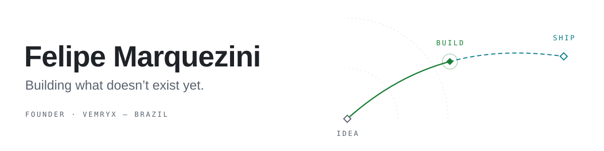

<picture>
  <source media="(prefers-color-scheme: dark)" srcset="assets/banner-dark.svg">
  
</picture>

I run [Vemryx](https://vemryx.com), a Brazilian software company that designs, ships and maintains its own products: Windows tools, AI-assisted systems and flight simulation software.

Most of what I build is local-first. No accounts, no telemetry, your data stays on your machine, and every change is explained before it happens.

### Now

**[Aeron](https://aero.vemryx.com)** &nbsp;·&nbsp; An AI copilot for Microsoft Flight Simulator that takes the FlyByWire A32NX from cold and dark to the runway, following the real SOP. 
**[FlyByWire](https://github.com/flybywiresim/aircraft/pulls?q=is%3Apr+author%3Amarquezinii)** &nbsp;·&nbsp; Sending fixes to the open-source A32NX and A380X: FMS, warnings, MFD and OANS. 
**[Ralven](https://vemryx.com/ralven/)** &nbsp;·&nbsp; Windows diagnostics and maintenance where every change is explained and reversible. On the Microsoft Store.

### Selected work

<table>
  <tr>
    <td valign="top" width="50%">
      <a href="https://github.com/marquezinii/axis"><b>axis</b></a> 
      Local control center for AI coding agents: finds them, inventories their skills and installs new ones with hashes and backups. 
      Tauri 2 · React · SQLite
    </td>
    <td valign="top" width="50%">
      <a href="https://github.com/marquezinii/follow-audit"><b>follow-audit</b></a> 
      See who doesn't follow you back on Instagram and TikTok. No password, no app, nothing leaves your browser. 
      TypeScript · <a href="https://marquezinii.github.io/follow-audit/">live</a>
    </td>
  </tr>
  <tr>
    <td valign="top">
      <a href="https://github.com/vemryx/V-Clicker"><b>V-Clicker</b></a> 
      Precise Windows autoclicker with a macro recorder and per-app profiles. One <code>.exe</code>, no network. 
      C# · .NET
    </td>
    <td valign="top">
      <a href="https://github.com/marquezinii/coding-skills-library"><b>coding-skills-library</b></a> 
      1,100+ portable Agent Skills for Claude Code, Codex and other coding agents, in one searchable repository. 
      Agent Skills · Node.js
    </td>
  </tr>
  <tr>
    <td valign="top">
      <a href="https://github.com/marquezinii/MD-Deep-Nations"><b>MD: Deep Nations</b></a> 
      Content-expansion submod for Millennium Dawn on Hearts of Iron IV, starting with a 62-focus modern US chapter. 
      Paradox script · Python
    </td>
    <td valign="top">
      <a href="https://github.com/aaif-goose/goose/pulls?q=is%3Apr+author%3Amarquezinii"><b>goose</b></a> 
      Merged fix to the open-source AI agent: deduplicating parallel tool-pair summaries when compacting context. 
      Rust · contribution
    </td>
  </tr>
</table>

### Tools I reach for

TypeScript · React · Astro · Electron · Tauri · C# / .NET · Python · Rust

 

<a href="https://vemryx.com">vemryx.com</a> &nbsp;·&nbsp; <a href="https://github.com/vemryx">github.com/vemryx</a> &nbsp;·&nbsp; <a href="https://x.com/marquez1ni">X @marquez1ni</a>
